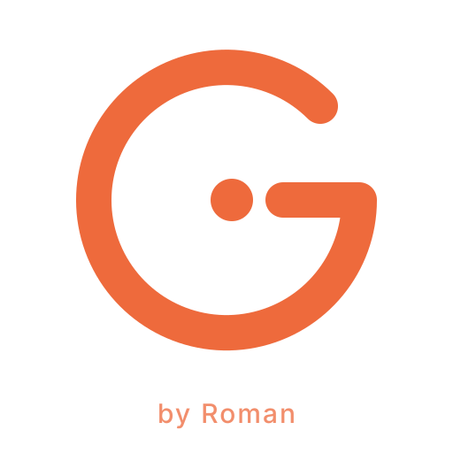

# G-Spot Assistant

Let Claude work with your Gmail, Google Calendar, Drive and Sheets, across all your Google accounts at once.

You run your own private copy. Nobody else can see your mail, and there is no subscription to pay to anyone but the host of your server.

## What you can ask Claude

- "Anything important unread across my inboxes?"
- "Reply to the plumber that Thursday works, and put it in my calendar."
- "Who still hasn't answered me? Draft polite reminders."
- "Save the contract from that email in my Drive, next to the others."
- "Send this tomorrow at 9:00."
- "Clean up my old promotions and unsubscribe me from the worst senders."

It also keeps a list of what you are waiting for, can email you a summary of it every week, and makes Claude show you the draft first when you write to people you cannot afford to upset (a lawyer, an administration, your landlord).

## Set it up

About 20 minutes, no coding. You need a Google account and a Claude account.

1. **Start your server.** Press the button, sign in to Railway (no GitHub account needed), type your Google email address in Configure, and deploy. [Part 1 of the setup guide](docs/SETUP.md#1-deploy-the-server) has the details and other hosts.

   
2. **Open your server's page.** It shows what is left to do, with the exact text to copy and paste.
3. **Connect it to Google** (10 minutes, free). Google asks every private app for its own key. [Part 2 of the guide](docs/SETUP.md#2-google-cloud-about-10-minutes) shows each click; at the end you paste two values into your server's settings.
4. **Link your Google accounts.** On your server's admin page, sign in and choose "Link an account" for each one: yours, a work account, a relative's with their agreement.
5. **Add it to Claude.** In Claude: Settings → Connectors → Add custom connector, and paste the address your server's page shows. It then works in Claude on the web, on your computer and on your phone.

Stuck? The [setup guide](docs/SETUP.md) has every step in detail.

## What it costs

- **The software:** nothing.
- **Google:** nothing.
- **The server:** Railway starts with a free trial (5 dollars of credit, no card needed). After that it is about 5 dollars a month. If you already have a server, it runs there with Docker at no extra cost.

## Your privacy

- Your copy runs on your own account. Nobody else can reach it, the authors included.
- It talks to Google and to your AI assistant, and to nothing else: no tracking, no statistics.
- Your Google sign-ins are stored encrypted. Your emails are not stored; a file you hand over through the chat is kept, encrypted, for a day at most.
- The code is open, so anyone can check all of this.

## Works with

- **Claude** on the web, in the desktop and mobile apps, and Claude Code.
- **ChatGPT** (developer mode): it should work, but nobody has tried it yet. [How to try](docs/SETUP.md#chatgpt-not-tested-yet).

## More

- [Setup guide](docs/SETUP.md): every step, for Railway or Docker.
- [Technical reference](docs/REFERENCE.md): all the tools, how it is built, settings, operations.
- [Security](SECURITY.md) and [contributing](CONTRIBUTING.md).

## License

Free software under the [GNU AGPL v3](LICENSE). If you run a modified copy for other people, the license asks you to share your changes.
